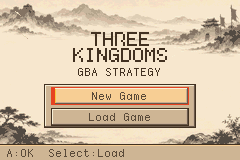
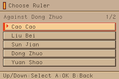
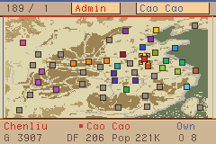
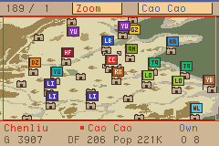
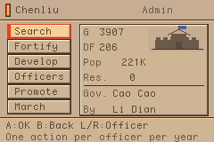
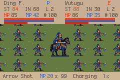

# Heroes of the Three Kingdoms GBA Demake

English | [简体中文](README.md)

[](https://github.com/Oliver714/hotk-gba-demake/actions/workflows/build.yml)
[Download ROMs](https://github.com/Oliver714/hotk-gba-demake/releases)

A Game Boy Advance demake based on the original *Heroes of the Three Kingdoms 1*. Features include city administration, army movement on the world map, army orders, battles, officer skills, equipment, and saves. The game targets a 240×160 display and uses Butano with custom rendering and music decoding.

The project is under active development. It aims to stay close to the original, but GBA resource and hardware limits lead to substantial differences. This repository builds independently without files from the original game.

## Screenshots

Game screens at their native 240×160 resolution.

| Title | Ruler selection |
|---|---|
|  |  |

| World map | Zoomed map |
|---|---|
|  |  |

| City management | Battle |
|---|---|
|  |  |

## Build a ROM

Linux x86_64 / WSL requires Python 3, make, g++, and xz-utils. Install the pinned toolchain:

```bash
sudo mkdir -p /opt/wonderful
sudo chown "$(id -u):$(id -g)" /opt/wonderful
python3 tools/install_toolchain.py
bash build.sh
```

Windows users with WSL Ubuntu-22.04 can run `./build.ps1` after installing the toolchain. The default output is `dist/sango_gba.gba`. Build in a path without spaces.

Builds use the generated resources checked into the repository; asset conversion dependencies are not required. Toolchain versions and SHA256 hashes are pinned in `toolchain.lock.json`. The first build downloads Butano using the revision and archive hash in `dependencies.lock.json`. It is cached in the Git-ignored `vendor/butano/` directory for subsequent builds.

Docker can also build the ROM without an ARM toolchain installed on the host:

```text
docker buildx build --platform linux/amd64 --target artifacts --output type=local,dest=./dist .
```

On Linux / WSL, use `bash tools/build_docker.sh`; add `--test` to run the regression tests as well. See the [build guide](docs/BUILD.en.md) for platform requirements, full instructions, and outputs.

Build the experimental English edition with `GAME_LANGUAGE=en bash build.sh`, or `./build.ps1 -Language en` on Windows. Its ROM, web bundle, and saves are separate from the Chinese edition. See the [English edition guide](docs/ENGLISH.md).

## Controls and saves

Use the D-pad to move the selection, A to confirm, and B to go back. Start, Select, and L/R vary by screen; follow the in-game hints. Keyboard mappings are configured in your emulator.

The game uses 128 KiB FLASH saves with eight slots. Save through the in-game menu; emulator save states are a separate feature. Back up your `.sav` before updating the ROM, and do not commit personal saves.

## Development and testing

Releases also include `hotk-gba-demake-web.zip` for browser play. See [web packaging and deployment](docs/WEB.en.md).

```bash
bash tools/test.sh
python3 tools/package_release.py  # Build the ROM first.
```

- [Project structure and validation limits](docs/DEVELOPMENT.en.md)
- [Local validation record](docs/VALIDATION.en.md)
- [Asset maintenance](docs/ASSETS.en.md)
- [Asset provenance and licensing status](docs/ASSET_PROVENANCE.en.md)
- [Save format](docs/SAVE_FORMAT.en.md)
- [GitHub Actions and releases](docs/RELEASING.en.md)
- [Contributing](CONTRIBUTING.en.md)
- [Changelog](CHANGELOG.en.md)

Regular pushes and pull requests run tests and build ROMs, available as Actions artifacts. Pushing a `v*` tag creates or updates the corresponding GitHub Release with ROMs, ZIP archives containing license notices, and checksums.

## Music, fonts, and portraits

- The two current background tracks are extracted from *Romance of the Three Kingdoms VI*: *Zhu Lu Tian Xia* (逐鹿天下) and *Feng Huo Bian Ye* (烽火遍野). They can be replaced using the bundled scripts; see [replacing music](docs/ASSETS.en.md#replacing-music).
- Fonts are third-party assets: ZLabs Pixel 12px is the primary font, with Source Han Mono used for missing glyphs. Original OFL licenses and source notes are retained in `assets/fonts/`.
- Character portraits are extracted from the original *Heroes of the Three Kingdoms 1*.

The project's GPL license does not relicense these third-party assets. See the [asset provenance inventory](docs/ASSET_PROVENANCE.en.md).

## License

Original project code is licensed under **GNU GPL version 3 only (GPL-3.0-only)**; see [LICENSE](LICENSE). Third-party code, fonts, art, and audio retain their own licensing status; see [third-party notices](THIRD_PARTY_NOTICES.md). Redistribution permissions for some historical generated assets still need verification. The GPL is not a blanket claim to all asset rights.

This project is not affiliated with or endorsed by the original game's rights holders.
