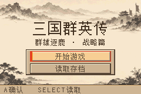
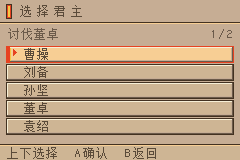
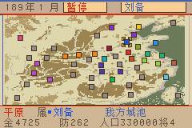
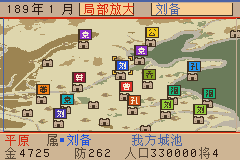
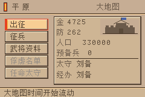
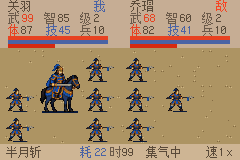

# 三国群英传 GBA Demake

[](https://github.com/Oliver714/hotk-gba-demake/actions/workflows/build.yml)
[下载 ROM](https://github.com/Oliver714/hotk-gba-demake/releases)

基于《三国群英传1》原版制作的 Game Boy Advance demake。包含内政、地图行军、部队指令、战场交战、武将技、装备及存档系统。目标画面为 240×160；使用 Butano 和自定义渲染、音乐解码实现。

当前为持续开发版本，GBA 版玩法不一定与原版一致。本仓库可独立编译，不需要原版游戏文件。

## 游戏截图

240×160 原始分辨率游戏画面。

| 标题画面 | 君主选择 |
|---|---|
|  |  |

| 大地图 | 局部地图 |
|---|---|
|  |  |

| 城池管理 | 战场交战 |
|---|---|
|  |  |

## 编译 ROM

Linux x86_64 / WSL，需要 Python 3、make、g++、xz-utils。安装固定版本工具链：

```bash
sudo mkdir -p /opt/wonderful
sudo chown "$(id -u):$(id -g)" /opt/wonderful
python3 tools/install_toolchain.py
bash build.sh
```

已配置 WSL Ubuntu-22.04 的 Windows 用户，安装工具链后也可运行 `./build.ps1`。默认输出 `dist/sango_gba.gba`。不要在含空格的路径中构建。

编译使用仓库内的生成资源，不需要安装素材转换依赖。工具链包版本及 SHA256 记录于 `toolchain.lock.json`，Butano 首次构建时自动下载，固定版本和下载校验值见 `dependencies.lock.json`；下载结果保存在被 Git 忽略的 `vendor/butano/`，后续构建复用，不再联网下载。

Docker 也可直接编译，宿主机无需安装 ARM 工具链：

```text
docker buildx build --platform linux/amd64 --target artifacts --output type=local,dest=./dist .
```

Linux / WSL 可使用 `bash tools/build_docker.sh`；添加 `--test` 同时运行回归测试。完整步骤、平台要求和输出说明见 [编译指南](docs/BUILD.md)。

## 操作与存档

方向键移动选择，A 确认，B 返回；Start、Select 与 L/R 的用途随页面变化，请参阅游戏内提示。模拟器的键盘映射由模拟器设置。

游戏使用 128 KiB FLASH 存档，提供 8 个槽位。请通过游戏内存档功能保存；模拟器即时存档是另外一套机制。更新 ROM 前备份个人 `.sav`，不要将其提交到仓库。

## 开发与测试

```bash
bash tools/test.sh
python3 tools/package_release.py  # 先完成构建
```

- [开发结构与验证范围](docs/DEVELOPMENT.md)
- [素材维护](docs/ASSETS.md)
- [素材来源与许可状态](docs/ASSET_PROVENANCE.md)
- [存档格式](docs/SAVE_FORMAT.md)
- [GitHub Actions 与发布](docs/RELEASING.md)
- [贡献指南](CONTRIBUTING.md)

普通推送及 PR 运行测试并构建 ROM，结果可在 Actions 下载。推送 `v*` 标签会自动创建或更新对应 GitHub Release，附上 ROM、含许可证的 ZIP 和校验值。

## 音乐、字体与头像来源

- 当前两首背景音乐提取自《三国志VI》的《逐鹿天下》和《烽火遍野》配乐。可通过内置脚本替换为其他音乐，步骤见 [素材维护](docs/ASSETS.md#替换音乐)。
- 游戏字体来自第三方：主字体为 ZLabs Pixel 12px，Source Han Mono 用于补齐缺字；各自的 OFL 许可证与来源说明保留在 assets/fonts/。
- 人物头像提取自《三国群英传1》原版游戏。

以上第三方素材不因项目代码采用 GPL-3.0 而改用该协议，具体来源及许可状态见 [素材清单](docs/ASSET_PROVENANCE.md)。

## 许可证

项目自有代码采用 **GNU GPL version 3 only（GPL-3.0-only）**，完整文本见 [LICENSE](LICENSE)。第三方代码、字体及美术/音频不自动改用 GPL，见 [THIRD_PARTY_NOTICES.md](THIRD_PARTY_NOTICES.md)。部分历史生成素材仍需核实再分发授权，详见来源清单；请勿把 GPL 理解为对所有素材权利的声明。

本项目与原游戏权利方无隶属或背书关系。

